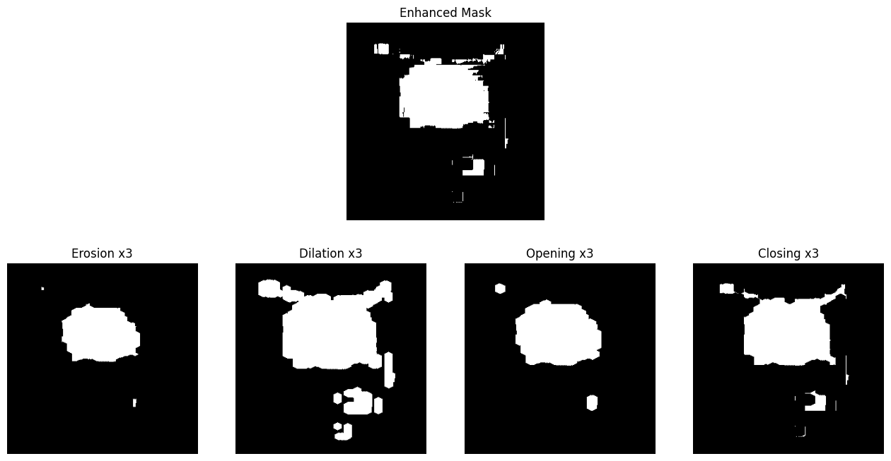
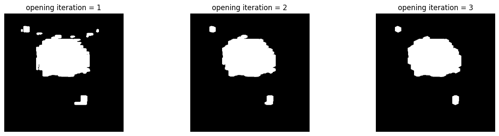
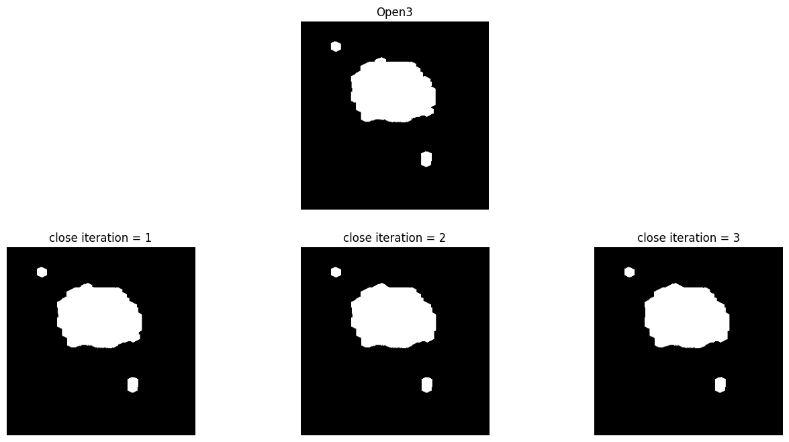

# Basketball Segmentation with Morphological Operation

'202235063_송태규_1017.py' file is about segmenting the basketball region and detecting its contour using morphological operations.

## Installation (Dependencies)

You can install the required libraries with:

```bash
pip install numpy matplotlib opencv-python
```

## Usage

You can run this file with:

```bash
python 202235063_송태규_1017.py
```

## Notes

- The image path is a relative path based on the repository structure (`../src/images/basketball_crop.jpg`), so please run the file from the folder where the script is located.
- If you get `ImportError: numpy.core.multiarray failed to import`, your NumPy and OpenCV versions do not match. Upgrade both with `pip install --upgrade numpy opencv-python`.

## Pipeline

1. Convert the BGR image to LAB color space
2. Apply CLAHE to the L channel (`clipLimit=3.0`, `tileGridSize=(8, 8)`)
3. Generate a binary mask with the LAB range (`[70, 130, 70]` ~ `[180, 230, 185]`)
4. Apply **Opening 3 times** (5x5 elliptical kernel)
5. Detect contours with `cv2.findContours` (`RETR_EXTERNAL`)
6. Select the largest contour as the basketball and draw it with a semi-transparent overlay

## Why I selected Opening

### Comparison of 4 morphological operations

The enhanced mask contains a lot of white noise, such as a horizontal band above the ball, thin vertical lines on the right, and small fragments below.
I applied each of the 4 operations (Erosion, Dilation, Opening, Closing) 3 times with the same kernel and compared the results.



| Operation | Result |
|---|---|
| Erosion | Removed the most noise, but the ball region also shrank. |
| Dilation | The noise grew too, and the upper band merged with the ball. |
| Opening | Removed the noise while keeping the ball size. Only 2 small separate blobs remained. |
| Closing | The upper band and right line stayed connected to the ball, so it barely removed any noise. |

Erosion gave the cleanest noise removal, but it shrinks the ball. Since the next steps compute the center and radius of the ball (minimum enclosing circle and centroid), a smaller ball region would give a smaller radius than the real one.
Opening is Erosion followed by Dilation, so it removes the noise first and then restores the size. That is why I selected Opening.

### Number of Opening iterations



- 1 time: Several small noise dots remained above the ball.
- 2 times: Most dots were removed, but a small bump remained on top of the ball.
- 3 times: The bump was also removed and the ball contour became the smoothest.

So I chose 3 iterations.

### Adding Closing after Opening

I also tried applying Closing 1~3 times after Opening 3 times to fill gaps on the ball boundary.



There were no holes inside the ball after Opening, so Closing made almost no difference. I skipped it as an unnecessary operation.

### Remaining noise

After Opening, 2 small blobs separate from the ball still remain, but they are excluded when selecting the largest contour.

Thank you for reading this README.md file!