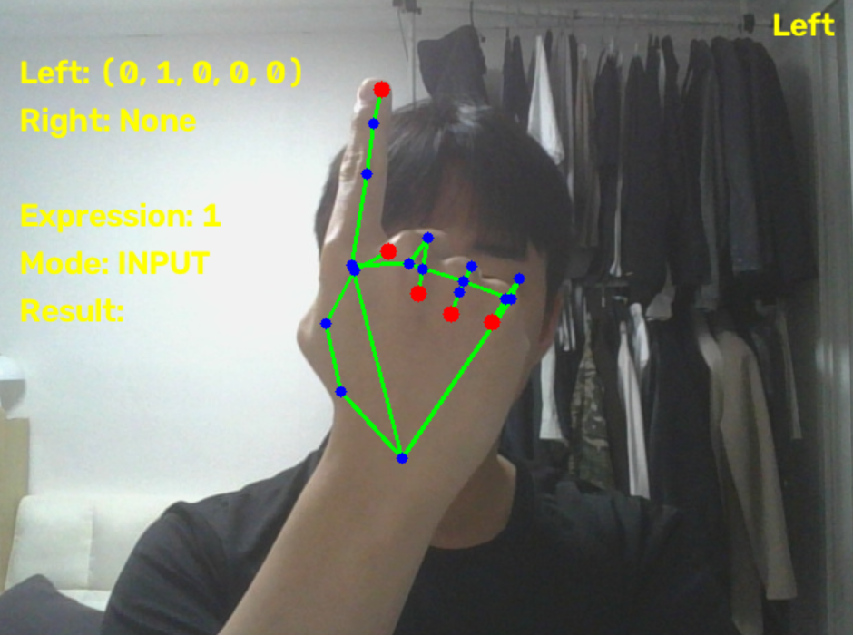
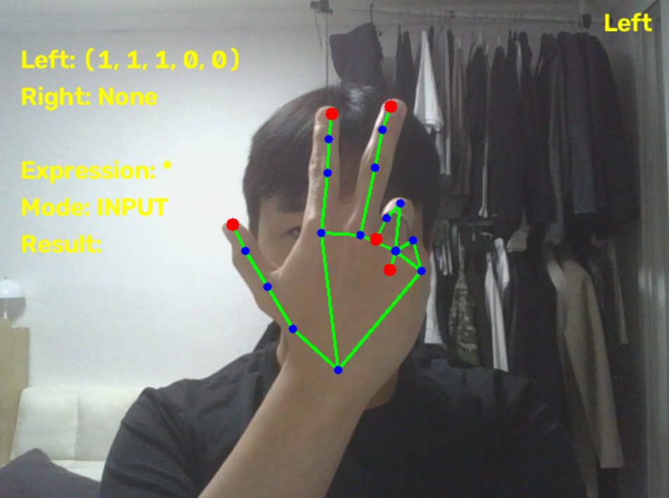
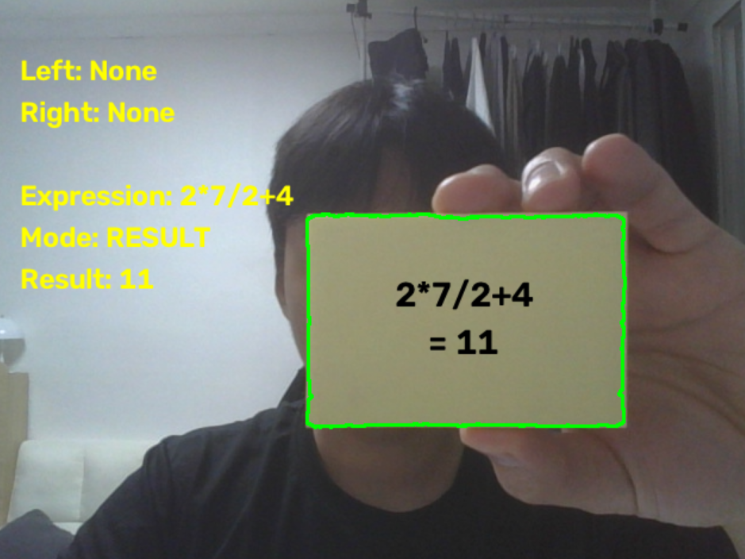
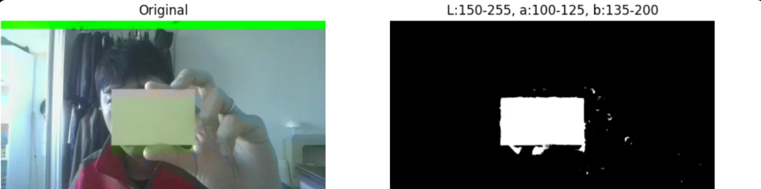
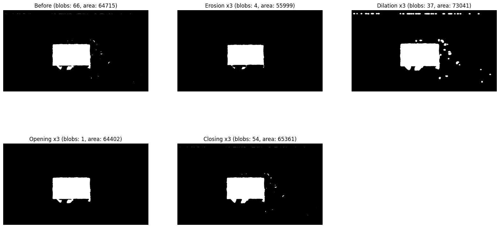
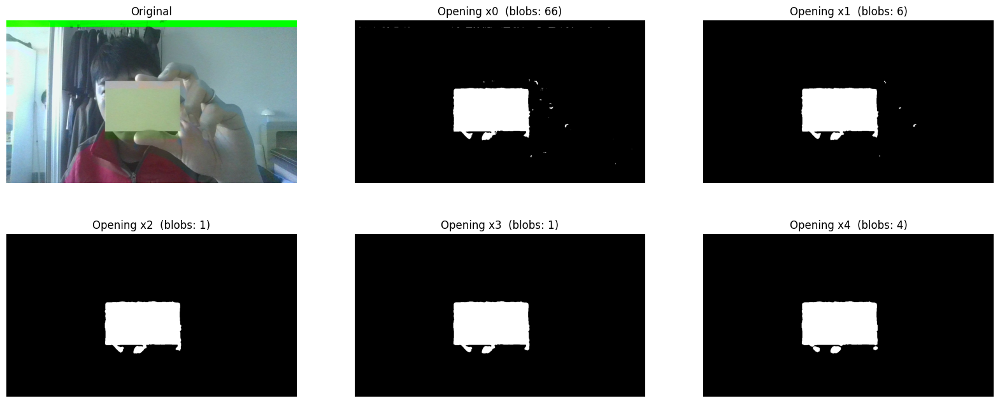

# 손동작 계산기 (Hand Gesture Calculator)

카메라로 손가락 모양을 인식해 숫자와 연산자를 입력하고, 노란 포스트잇을 카메라에 보이면 계산 결과를 포스트잇 위에 표시하는 프로그램입니다.
MediaPipe로 손가락 상태를 판별하고, OpenCV로 포스트잇을 검출한 뒤 Kalman Filter로 위치를 추적합니다.

## 실행 환경

- Windows 노트북 (웹캠)
- NVIDIA Jetson Nano (USB 카메라, GStreamer 파이프라인)
- Python 3.10.4

## 의존성

```bash
pip install opencv-python numpy mediapipe
```

- Jetson Nano에서는 GStreamer가 활성화된 OpenCV가 필요합니다.
- 손 검출 모델 파일 `hand_landmarker.task`를 `src/models/MediaPipe/` 경로에 두어야 합니다.

## 폴더 구조

```
Project01/
├── handCalculator.py
├── README.md
├── images/
│   ├── gesture_digits.png
│   ├── gesture_operators.png
│   ├── lab_lower_upper_detection.png
│   ├── CMP_morphology.png
│   ├── CMP_opening_count.png
│   └── result.png
└── src/models/MediaPipe/hand_landmarker.task
```

## 실행 방법

```bash
python handCalculator.py
```

- `q` 키를 누르면 종료합니다.
- OS를 자동으로 판별합니다. Windows이면 `cv2.VideoCapture(0)`, 그 외(Jetson)이면 GStreamer 파이프라인(`/dev/video0`, 640x480, 30fps)으로 카메라를 엽니다.
- 화면 반전도 OS별로 다릅니다. Windows는 좌우 반전(거울 모드), Jetson은 상하 반전입니다.

## 사용 방법

### 1. 숫자 입력

손가락을 **하나만** 펴고 1초 유지하면 숫자가 입력됩니다.

| 손가락 | 엄지 | 검지 | 중지 | 약지 | 소지 |
|---|---|---|---|---|---|
| 왼손 | 0 | 1 | 2 | 3 | 4 |
| 오른손 | 5 | 6 | 7 | 8 | 9 |



*왼손(0~4), 오른손(5~9)*

### 2. 연산자 입력

| 제스처 | 연산자 |
|---|---|
| 왼손 검지+중지 (브이) | + |
| 왼손 엄지+검지+중지 | * |
| 오른손 검지+중지 (브이) | - |
| 오른손 엄지+검지+중지 | / |



### 3. 입력 규칙

- 제스처를 **1초(`HOLD_TIME`) 이상 유지**해야 입력됩니다. 유지 시간은 화면에 표시됩니다.
- 한 번 입력한 뒤에는 **중립 상태**(양손 모두 주먹이거나 화면 밖)를 거쳐야 다음 입력을 받습니다. 같은 제스처가 연속으로 입력되는 것을 막기 위함입니다.
- **양손이 동시에 제스처**를 하면 모호하므로 무시합니다.
- 숫자를 연속으로 입력하면 여러 자리 수가 됩니다. (예: 1, 2 입력 → 12)

### 4. 결과 확인

1. 노란 포스트잇을 카메라 앞에 보이면 약 10프레임(`SHOW_FRAMES`) 뒤 결과 모드로 바뀝니다.
2. 포스트잇 위에 수식과 결과가 두 줄로 표시됩니다. (예: `3+7` / `= 10`)
3. 결과 모드에서는 손가락 입력을 무시합니다.
4. 포스트잇이 약 30프레임(`HIDE_FRAMES`, 약 1초) 이상 보이지 않으면 수식이 초기화되고 입력 모드로 돌아갑니다.

### 예시: 2*7/2+4

1. 왼손 중지만 펴고 1초 유지 → `2`
2. 주먹 (중립)
3. 왼손 엄지+검지+중지 1초 유지 → `2*`
4. 주먹 (중립)
5. 오른손 중지만 펴고 1초 유지 → `2*7`
6. 주먹 (중립)
7. 오른손 엄지+검지+중지 1초 유지 → `2*7/`
8. 주먹 (중립)
9. 왼손 중지만 펴고 1초 유지 → `2*7/2`
10. 주먹 (중립)
11. 왼손 브이 1초 유지 → `2*7/2+`
12. 주먹 (중립)
13. 왼손 소지만 펴고 1초 유지 → `2*7/2+4`
14. 주먹 (중립)
15. 포스트잇을 보이면 `2*7/2+4 = 11`이 포스트잇 위에 표시됨
16. 포스트잇을 숨기면 초기화



*결과 모드 화면. 곱셈과 나눗셈이 먼저 계산되어 `2*7/2 = 7`, `7+4 = 11`이 됨. 포스트잇 위에 수식과 결과가 표시되고, 좌측 상단에는 현재 모드와 입력된 수식이 표시됨*

## 동작 원리

### 손가락 판별

- MediaPipe HandLandmarker(최대 2손)로 21개 landmark를 검출합니다.
- 각 손가락의 세 관절이 이루는 각도를 계산해, 160도 이상이면 펴짐(1), 미만이면 접힘(0)으로 판단합니다.
- 손마다 5개 값의 튜플(엄지~소지)을 만들고, 왼손/오른손 라벨은 거울 모드 화면 기준으로 보정합니다.

### 계산

- 수식 문자열을 숫자와 연산자 토큰으로 분리한 뒤, 곱셈·나눗셈을 먼저 계산하고 덧셈·뺄셈을 왼쪽부터 계산합니다.
- 결과가 정수면 소수점 없이, 아니면 소수점 2자리까지 표시합니다.
- 다음 경우에는 `Error`를 표시합니다.
  - 0으로 나누기
  - 연산자가 연속으로 입력된 경우
  - 연산자로 끝나는 수식 (예: `3+`)

### 포스트잇 검출

1. 가우시안 블러 후 BGR → LAB 변환
2. L 채널에 CLAHE를 적용해 조명 변화에 대응
3. 노란색 LAB 범위(`L:150-255, a:100-125, b:135-200`)로 이진 마스크 생성
4. 모폴로지 Opening(3회)으로 노이즈 제거
5. 가장 큰 contour를 선택하고, 면적이 `MIN_AREA`(3000) 이상일 때만 포스트잇으로 인정
6. 최소 외접원으로 중심 좌표 계산

#### LAB 색 범위로 마스크 생성



*노란 포스트잇만 흰색으로 분리됨. 손가락이나 배경의 잔여 노이즈가 일부 남음*

#### 모폴로지 연산 비교


*Opening(blobs: 1)만 노이즈를 제거하면서 포스트잇 면적(64402)을 거의 유지함. Erosion은 면적이 줄고, Dilation과 Closing은 노이즈가 오히려 늘어남*

#### Opening 반복 횟수 비교


*1회는 노이즈가 남고(blobs: 6), 2~3회에서 포스트잇 하나만 남음(blobs: 1). 4회는 다시 노이즈 조각이 생겨(blobs: 4) 3회를 사용*

### Kalman Filter 추적

- 상태 `[x, y, vx, vy]`, 측정 `[x, y]`인 등속 모델(`cv2.KalmanFilter(4, 2)`)을 사용합니다.
- 포스트잇이 검출되면 예측과 보정을 모두 수행하고, 손에 가려져 검출되지 않으면 예측만 수행합니다. 덕분에 포스트잇이 잠깐 가려져도 글자가 유지되고, 움직임도 부드럽게 따라갑니다.
- 처음 검출된 위치로 상태를 초기화하고, 약 1초 이상 보이지 않으면 추적을 해제합니다.

## 주요 파라미터

| 이름 | 값 | 설명 |
|---|---|---|
| `angle_threshold` | 160 | 손가락 펴짐 판단 각도 |
| `HOLD_TIME` | 1.0초 | 제스처 유지 시간 |
| `SHOW_FRAMES` | 10 | 결과 모드로 전환하는 포스트잇 연속 검출 프레임 수 |
| `HIDE_FRAMES` | 30 | 입력 모드로 돌아가는 미검출 프레임 수 |
| `MIN_AREA` | 3000 | 포스트잇으로 인정하는 최소 면적 |
| `processNoiseCov` | 1e-2 (위치), 5e-2 (속도) | 클수록 측정값 변화에 빠르게 반응 |
| `measurementNoiseCov` | 1.0 | 클수록 측정값을 덜 신뢰 |

## 참고 사항

- 포스트잇 색상 범위(LAB)는 조명과 포스트잇 종류에 따라 조정이 필요할 수 있습니다. 실행 중 `Postit Mask` 창에서 검출 결과를 확인할 수 있습니다.
- 정수 숫자만 입력할 수 있고, 한 글자 지우기 기능은 없습니다.
- Windows와 Jetson Nano 외의 환경(Mac, 일반 리눅스)에서는 카메라가 열리지 않을 수 있습니다.
- 모델이 두 손을 모두 같은 라벨로 판정하면 한 손의 상태가 덮어써질 수 있습니다.
